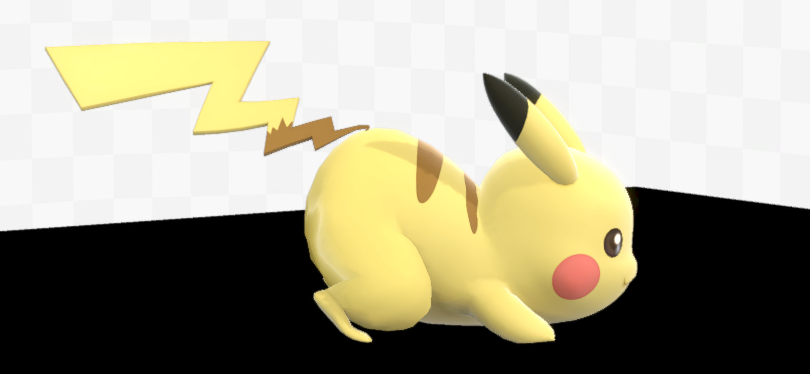
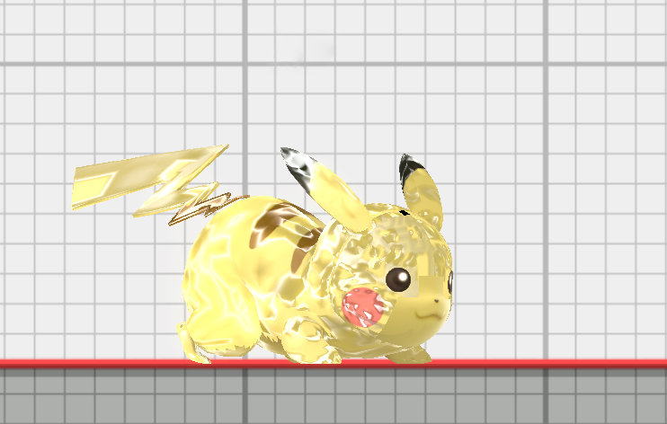

# Renormal Materials
A small number of shaders in game support recalculating vertex normals in the vertex shader. Recalculating normals can reduce shading artifacts for certain animations like Pikachu's crawl. 

<figure class="figure">
    
    <input type="radio" id="pikachuNoRenormal" name="pikachu" value="pikachuNoRenormal" checked>
    <label for="pikachuNoRenormal">Crawl</label>
    <input type="radio" id="pikachuRenormal" name="pikachu" value="pikachuRenormal">
    <label for="pikachuRenormal">Crawl (Renormal)</label>
</figure>

The model.adjb file stores the adjacent faces for each vertex for certain meshes from the model.numshb. This allows the game to recalculate smooth vertex normals by calculating the normal from each adjacent face's positions and averaging them together.

<figure class="figure">
    
    <figcaption>Renormal materials with missing entries in the model.adjb.</figcaption>
</figure>

Meshes that have materials that recalculate normals but no entry in the model.adjb will have broken normals in game like in the screenshot above. SSBH Editor can automatically detect this and provides ways to easily create a missing model.adjb or add missing entries to an existing model.adjb.

Materials with shaders that recalculate normals typically have material labels that begin with the "RENORMAL_" prefix like "RENORMAL_skin_pikachu_001". The material name itself does not control whether the renormals are recalculated or not. Only the following shaders support recalculating normals. Add an appropriate suffix like "_opaque" when using the shader in SSBH Editor.

```
SFX_PBS_0110000008008269
SFX_PBS_011000000800826b
SFX_PBS_0110400008008269
SFX_PBS_011040000800826b
SFX_PBS_0130000008008269
SFX_PBS_013000000800826b
SFX_PBS_0130400008008269
SFX_PBS_013040000800826b
```


<script type="text/javascript">
    const pikachuNoRenormal = document.getElementById("pikachuNoRenormal");
    const pikachuRenormal = document.getElementById("pikachuRenormal");

    const pikachuImg = document.getElementById("pikachuImg");

    function imgRadios() {
        if (pikachuNoRenormal.checked) {
            pikachuImg.src = "pikachu_no_renormal.jpg";
        }
        if (pikachuRenormal.checked) {
            pikachuImg.src = "pikachu_renormal.jpg";
        }
    }

    pikachuNoRenormal.onclick = imgRadios;
    pikachuRenormal.onclick = imgRadios;
</script>